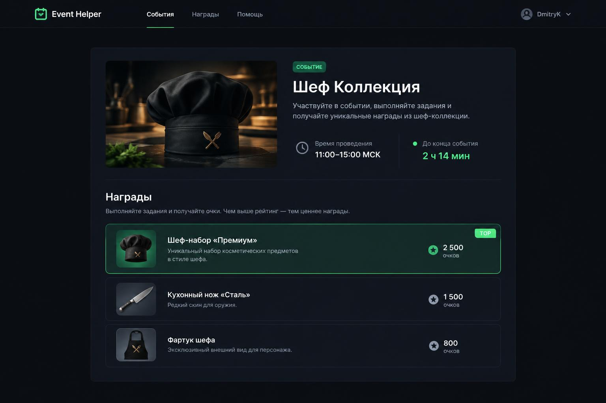
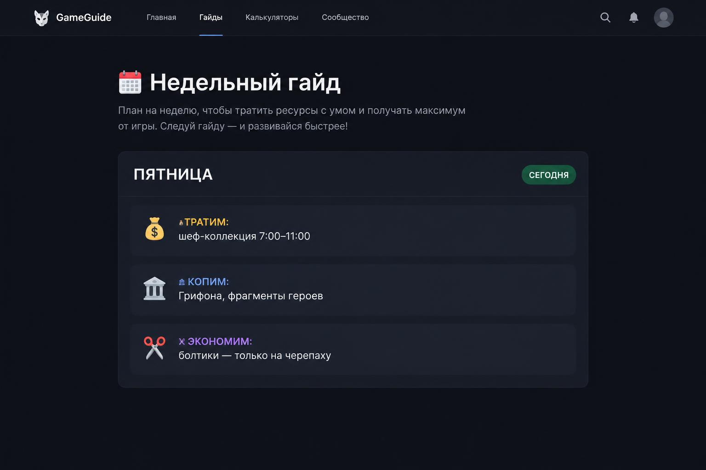
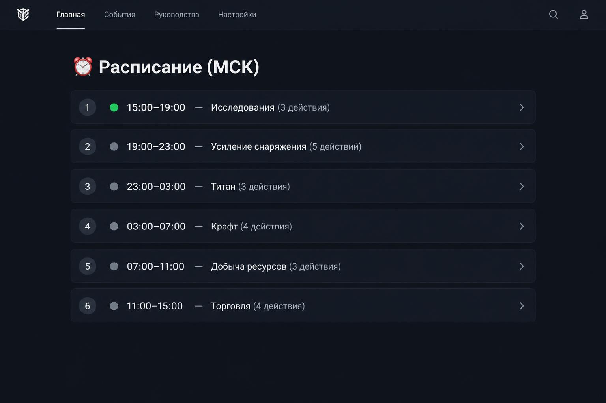
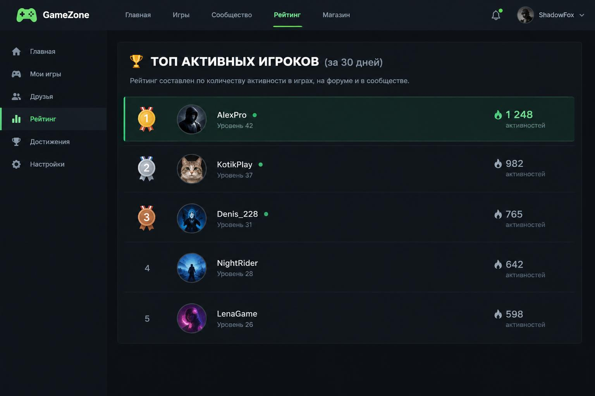
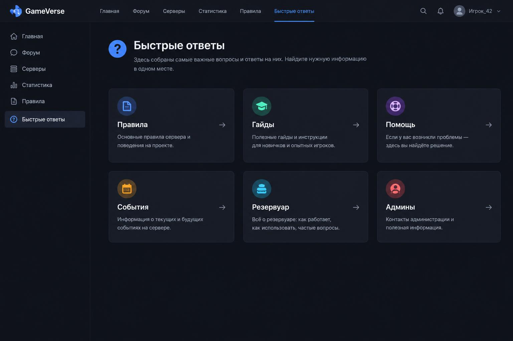
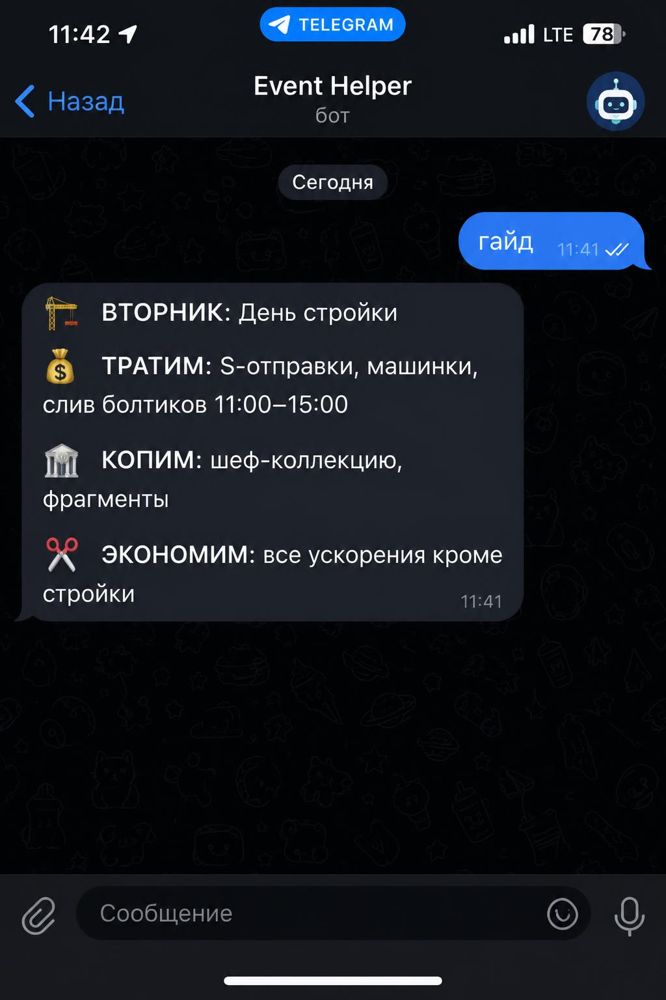
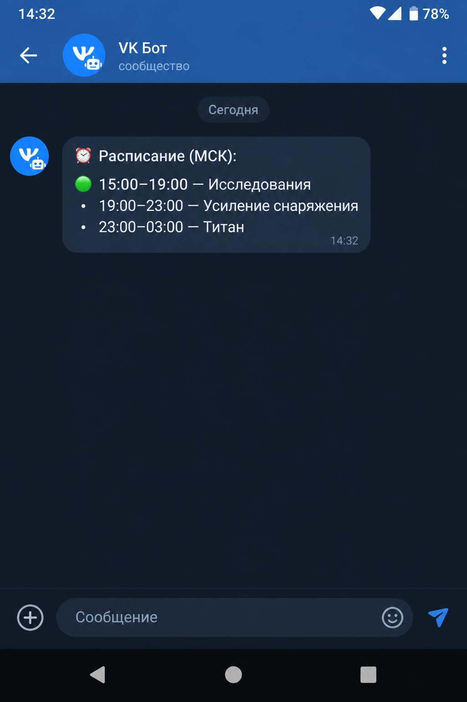
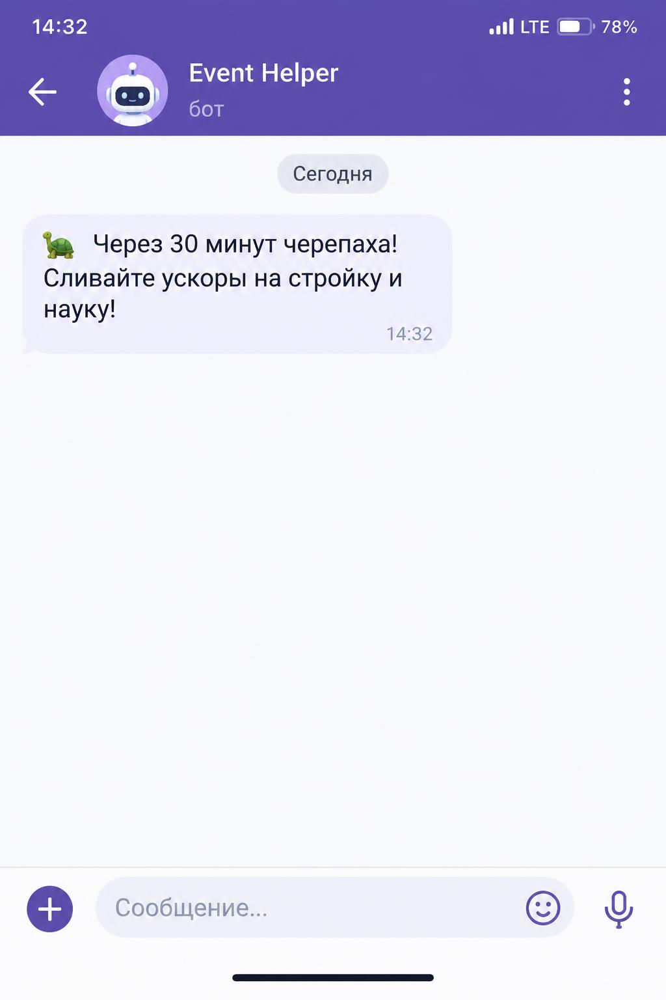

# event-helper-bot 🎮

[](https://github.com/mrkoster1988/event-helper-bot/actions/workflows/ci.yml)

Бот-трекер событий игры **Tiles Survive!** для клана: расписание окон,
гайды по дням, ники и топ игроков. Telegram + VK + MAX.
Сайт-компаньон: [event-helper](https://gitlab.com/mrkoster/event-helper).

## Возможности

### Игрок
- **Расписание окон** — что сейчас активно, что дальше, с таймером (МСК)
- **Гайд на сегодня** — что тратить, что копить, что экономить
- **Гайд недели** — все 7 дней, текущий с бейджем «СЕГОДНЯ»
- **Поиск по названию** — написал «Титан» — получил награды окна
- **Быстрые ответы** — правила, гайды, резервуар, помощь

### Клан
- **Ники** — `!ник Имя` с проверкой занятости
- **Топ активных** — `!топ` за 30 дней (🥇🥈🥉)
- **Моя статистика** — `!я`: дни активности, первое обращение
- **Ежедневная рассылка** — гайд дня в общий чат в 09:00

### Админ
- Все данные — в одном файле `bot/data.py` (комментарии внутри)
- `!скази`, `!пауза`, `!запуск`, `!статус`, `!статистика`, `!админы`
- VK: удаление последнего сообщения бота

### Под капотом
- Единое ядро `core.py` + адаптеры платформ (Telegram/VK/MAX)
- Данные бота и сайта согласованы: `bot/data.py` ↔ `data.js`
- Напоминания: 09:00 утро, 13:45 регистрация на Резервуар, 14:30 черепаха, 18:00 VS
- Активность по дням за 30 дней (без бага исходного скрипта)
- CI: тесты при каждом пуше, Docker-сборка на тегах (`.gitlab-ci.yml`)

## Скриншоты

### Карточка события с таймером


### Гайд недели с бейджем «СЕГОДНЯ»


### Расписание окон на сутки


### Топ игроков за 30 дней


### Быстрые ответы (FAQ)


### Telegram: гайд на сегодня


### VK: расписание окон


### MAX: напоминание про черепаху


## Стек

- Python 3.12, aiogram 3.x (Telegram), vk_api (VK), Bot API MAX
- Docker / docker-compose
- CI: GitLab CI

## Установка

```bash
git clone https://gitlab.com/mrkoster/event-helper-bot.git
cd event-helper-bot
cp .env.example .env   # заполнить токены и чаты
docker compose up -d --build
```

## Запуск без Docker

```bash
pip install -r requirements.txt
python -m bot
```

## Структура

```
bot/
  config.py            # токены, чаты, админы из .env
  data.py              # ВСЕ ДАННЫЕ (файл админов)
  core.py              # логика: окна, счётчики, handle()
  players.py           # ники и активность (players.json)
  __main__.py          # запуск платформ
  platforms/
    telegram.py        # aiogram 3.x
    vk.py              # vk_api longpoll
    max.py             # Bot API MAX
```

## Лицензия

MIT — см. [LICENSE](LICENSE).
